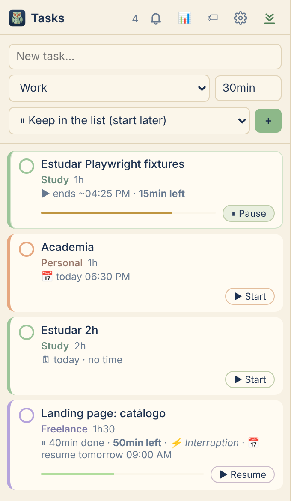
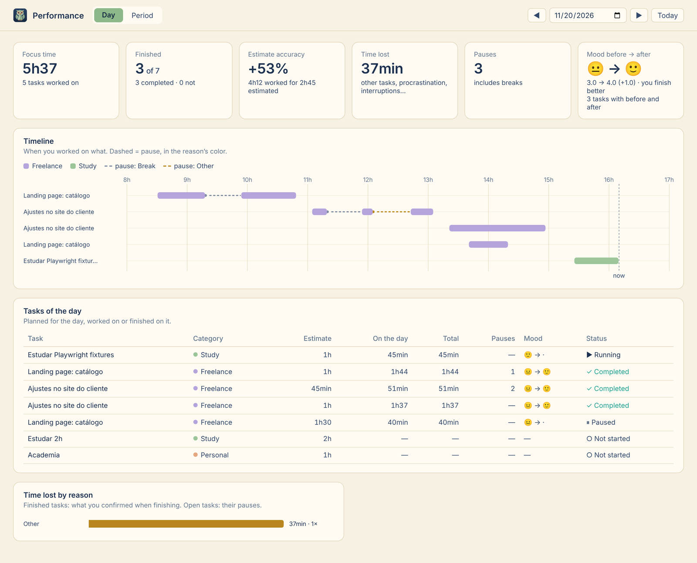
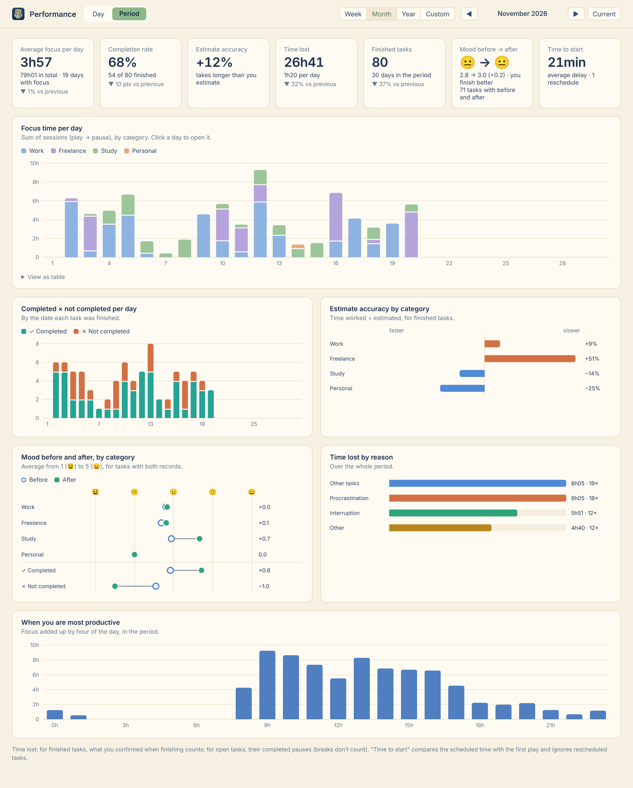

<div align="center">


# My Owl Planner Lite

**A Windows desktop task widget that shows how much time you really spend on your tasks.**
Time estimates, an always-on-top progress bar and a performance dashboard. Offline and account-free, with all data kept on your PC.

[](../../releases/latest)


**English** · [Português](README.pt-BR.md)

### [⬇️ Download the latest version](../../releases/latest)

[Step-by-step installation guide](#installation) · Windows 10 and 11 · Free

</div>

<table>
  <tr>
    <td width="30%" valign="top"></td>
    <td valign="top"></td>
  </tr>
</table>

> This is the **Lite edition** of a larger personal project, published as a portfolio piece.

## Why

My Owl Planner helps you **stay focused on one task at a time** and then **understand how you really use your time**. You give each task an estimate and press play; a thin bar keeps the clock in sight while you work. Afterwards, your own numbers show how close your estimates were, what got in the way and when you focus best.

It isn't here to watch over you: you set the estimates, you say why you paused, you judge how it went, and nobody else sees the data. The conclusions are yours.

## Features

**Tasks**
- Quick entry with a time estimate (`30`, `45min`, `1h30`, `1,5h`) and color-coded categories
- Start now, keep in the list, plan for a day or schedule a time
- Play / pause with a pause reason. Only one task runs at a time.
- Finish as completed or not, log what got in the way, and record your mood before and after

**Always visible**
- A thin **progress bar on top of every window** (top, bottom or either side) that goes green → yellow → red and blinks when you run over
- By default the bar **shows up every few minutes** (1 to 5, your choice) for about 3 seconds and fades away, so it never covers window buttons like the close X. It also appears when you start, pause or run over a task. Prefer it always on? One setting.
- The **taskbar button** mirrors the progress and opens or collapses the panel with a click
- **Owl notifications**: periodic reminder, time's up, time to start, task done. They come with an optional hoot and rotating messages, and you can add your own.

**Dashboard**
- **Day:** focus time, completion, estimate accuracy, time lost, pauses and mood, plus a timeline and a table of the day's tasks
- **Period** (week, month, year or custom, compared with the previous one): focus per day by category, completed × not completed, estimate accuracy by category, mood by category, time lost by reason and your most productive hours

<p align="center"></p>

**And also**
- Demo mode with ~2 years of simulated data, kept apart from your own
- Daily automatic backup (keeps the last 10) and full JSON export
- Built-in updates from GitHub Releases
- **Light and dark themes** (light by default), for every window
- English, Portuguese and Spanish
- **Help built in:** report a bug or send a message straight from the app

**Settings** (one window, saved instantly)
- Language and theme; start with Windows; start collapsed
- Bar position (top, bottom, left, right), thickness, and when it shows (every 1–5 min or always)
- Panel side, open on hover, reminder interval, which notifications to show, hoot on/off, mood prompt
- Message tone and your own messages
- Data: back up now, open the data folder, export everything (JSON)
- About: version, check for updates, help and contact, links

## Installation

It takes about a minute. Windows may show one or two warnings along the way; they are expected for a new, independent app and are explained below.

### 1. Download

Open the [latest release](../../releases/latest) and, under **Assets**, download one of these files:

| File | Use it if |
|---|---|
| `My-Owl-Planner-Lite-Setup-<version>-x64.exe` | **Recommended.** Installs the app with Start menu and desktop shortcuts, and lets you uninstall it like any other program. |
| `My-Owl-Planner-Lite-<version>-portable.exe` | You want to run it without installing, for example to try it out or from a USB drive. |

> **If your browser warns about the download** (for example, Edge saying the file *"isn't commonly downloaded"*): this only means few people have downloaded it yet. In the downloads list, click **⋯ → Keep**, then **Show more → Keep anyway**.

### 2. Open the file — the "Windows protected your PC" screen

When you open the installer, Windows may show a blue **Microsoft Defender SmartScreen** window saying *"Windows protected your PC"*.

**Why it appears:** Windows shows this for apps that aren't signed with a paid code-signing certificate and that it hasn't seen many times yet. It's common with independent and open-source apps. It doesn't mean a virus was found.

**To continue:**
1. Click **More info**.
2. Check that the app name is **My-Owl-Planner-Lite-Setup-…exe**.
3. Click **Run anyway**.

You only need to do this the first time.

> **Want to be extra careful?** Before opening it, right-click the downloaded file and choose **Scan with Microsoft Defender** (on Windows 11 it's under **Show more options**). The full source code is also right here in this repository.

### 3. Install

1. Choose where to install (the suggested folder is fine). **No administrator password is needed**: the app installs only for your Windows user.
2. Click **Install**, then **Finish**. My Owl Planner Lite opens right away.

### 4. First steps

- The **owl appears on the taskbar**. Click it to open or collapse the panel.
- The full menu (Dashboard, Settings, Quit) is in the **owl icon next to the clock**. If you don't see it, click the **^** arrow next to the clock; you can drag the owl out of there to keep it always visible.
- Want to see it full of data first? Use **tray → 🧪 Open demo mode**. It has about two years of simulated data and never mixes with yours.

### Portable version

Just open the `.exe`; there is no setup. The same SmartScreen screen may appear (step 2). Your data is saved in the same place as the installed version, and the portable version can update itself too.

### Uninstall

Go to **Settings → Apps → Installed apps**, find **My Owl Planner Lite** and choose **Uninstall**.
Your tasks are **not** deleted: they stay in `%APPDATA%\my-owl-planner-lite`, so a reinstall picks up where you left off. To remove everything, delete that folder too.

### Requirements

Windows 10 or 11, 64-bit. ARM laptops (e.g. Snapdragon) run it through Windows' x64 emulation. Windows 7, 8 and 8.1 are not supported (an Electron limit).

### Updates

**Settings → About → Check for updates** looks for a newer release. If there is one, the app asks before doing anything:

- **Installed:** downloads, updates silently and reopens.
- **Portable:** downloads the new `.exe` and swaps it for the current one.

It also checks on startup by default and lets you know through an owl notification (you can turn that off). Your tasks are never touched.

## Tech stack

| | |
|---|---|
| **Desktop** | [Electron](https://www.electronjs.org/) with `contextIsolation`. Each window talks to the main process only through a small preload API. |
| **Storage** | SQLite through Node's built-in `node:sqlite`, so there are no native modules to compile. Schema versioning and migrations are included. |
| **Charts** | Hand-written SVG with no chart library, and tooltips and a table view for accessibility |
| **i18n** | A small in-house dictionary (EN / PT / ES) with plural forms, applied to every window and the tray |
| **Themes** | CSS variables per window; a tiny script applies the saved theme before the first paint and the main process broadcasts changes to every open window (and to native dialogs) |
| **The bar** | A frameless, transparent, always-on-top window. When hidden it becomes click-through (`setIgnoreMouseEvents`), so it never blocks the apps underneath; progress is mirrored on the taskbar button (`setProgressBar`) |
| **Packaging** | `electron-builder`: NSIS installer and portable `.exe` |
| **Updates** | `electron-updater` for the installed version. For the portable version, a custom updater calls the GitHub Releases API and swaps the `.exe`. |

### Project structure

```
main.js              main process: windows, bar placement, tray, notifications, backup, theme, updates, links
updater.js           update check and install (installer and portable)
db.js                SQLite storage and migrations
analytics.js         metrics (focus, accuracy, time lost, mood, productive hours)
demo-data.js         simulated data for demo mode
i18n.js              translations (EN / PT / ES)
messages.js          notification messages (EN / PT / ES)
theme.js             light / dark theme, applied before each window paints
index.html, renderer.js, styles.css           widget: tasks, timer, pause/finish dialogs, the bar
dashboard.html, dashboard.js, dashboard.css   dashboard views and SVG charts
settings.html, settings.js, settings.css      settings window (incl. About, help and links)
toast.html, toast.js, toast.css               the owl notification that slides out of the bar
*-preload.js         one small, isolated bridge per window
.github/ISSUE_TEMPLATE/   bug report and idea forms
docs/img/            README screenshots
```

## Run from source

Requires Node.js 22+ on Windows.

```bash
npm install
npm start        # open the app with your data
npm run demo     # open it with simulated data
npm run dist     # build the installer and the portable .exe into dist/
```

Data lives in `%APPDATA%\my-owl-planner-lite\tasks.db`. Uninstalling the app does **not** delete it.

<details>
<summary><b>Publishing a new version</b></summary>

1. Bump `version` in `package.json` (e.g. `1.0.1`) and run `npm run dist`.
2. Create a GitHub Release tagged `v1.0.1` and attach, from `dist/`:
   - `My-Owl-Planner-Lite-Setup-1.0.1-x64.exe`
   - `My-Owl-Planner-Lite-Setup-1.0.1-x64.exe.blockmap`
   - `latest.yml` (this is what installed copies check)
   - `My-Owl-Planner-Lite-1.0.1-portable.exe`

</details>

## Feedback

- 🐞 **Found a bug?** [Open a bug report](../../issues/new?template=bug_report.yml) — or use **Settings → About → Report a bug** in the app, which fills in the versions for you.
- 💡 **Have an idea?** [Suggest it here](../../issues/new?template=feature_request.yml).
- ✉️ **Anything else:** [gabriel@gabrielcastro.net](mailto:gabriel@gabrielcastro.net)

## Follow My Owl Planner

[Website](https://myowlplanner.com) · [Instagram](https://www.instagram.com/myowlplanner/) · [LinkedIn](https://www.linkedin.com/company/myowlplanner/)

## Meet the maker


Made by **Gabriel Castro**, QA Automation Engineer. Almost 10 years working in tech, 5 of them in QA. My Owl Planner started as a tool to solve a problem of my own and grew into something that can help a lot of people.
[LinkedIn](https://www.linkedin.com/in/gncastro/) · [GitHub](https://github.com/gabrielnecastro) · [gabrielcastro.net](https://gabrielcastro.net) · [gabriel@gabrielcastro.net](mailto:gabriel@gabrielcastro.net)
<br clear="left" />

## License

© 2026 Gabriel Castro. All rights reserved. The source is published for portfolio and evaluation purposes only. See [LICENSE](LICENSE). What changed in each version: [CHANGELOG](CHANGELOG.md).
