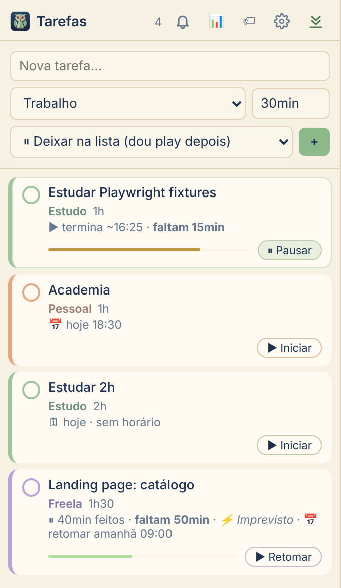
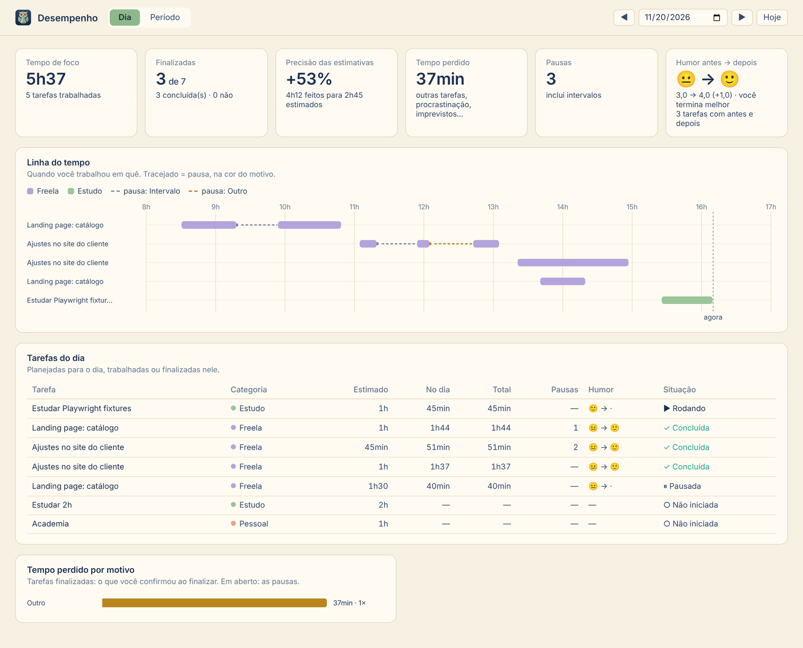
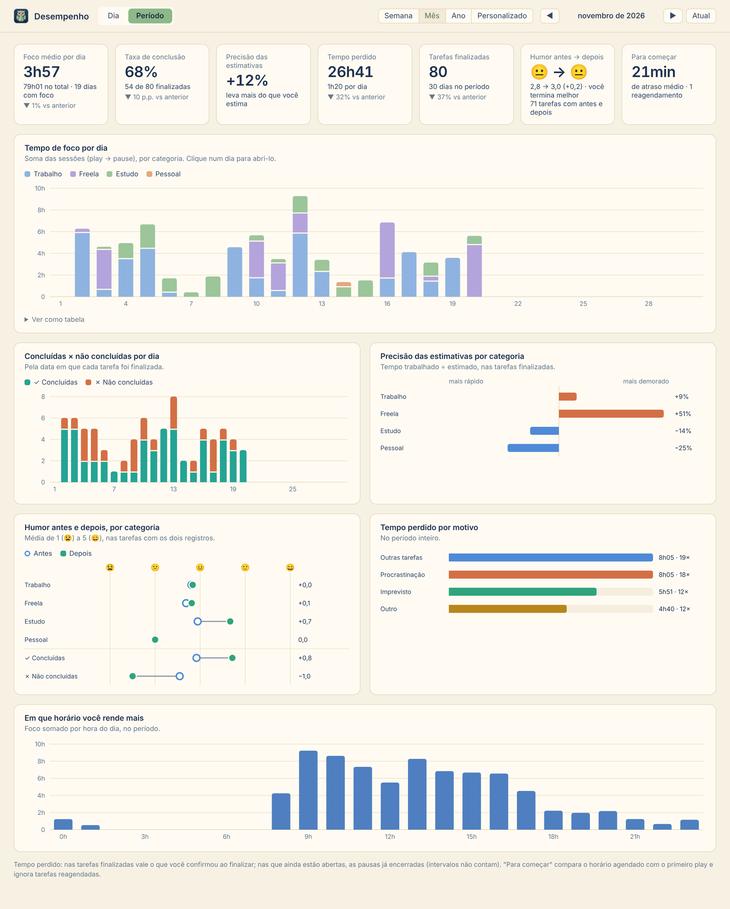

<div align="center">


# My Owl Planner Lite

**Um widget de tarefas para Windows que mostra quanto tempo você realmente dedica às suas tarefas.**
Tempo estimado, barra de progresso sempre visível e um dashboard de desempenho. Funciona offline e sem conta, e os dados ficam no seu PC.

[](../../releases/latest)


[English](README.md) · **Português**

### [⬇️ Baixar a versão mais recente](../../releases/latest)

[Passo a passo da instalação](#instalação) · Windows 10 e 11 · Grátis

</div>

<table>
  <tr>
    <td width="30%" valign="top"></td>
    <td valign="top"></td>
  </tr>
</table>

> Esta é a **edição Lite** de um projeto pessoal maior, publicada como portfólio.

## Por quê

O My Owl Planner te ajuda a **manter o foco em uma tarefa de cada vez** e depois a **entender como você realmente usa o seu tempo**. Você dá uma estimativa para a tarefa e aperta play; uma barra fininha deixa o relógio à vista enquanto você trabalha. Depois, os seus próprios números mostram o quanto você acertou nas estimativas, o que te atrapalhou e em que horário você rende mais.

Ele não foi feito para vigiar ninguém: você define as estimativas, diz por que pausou, avalia como foi, e ninguém mais vê os dados. As conclusões são suas.

## Funcionalidades

**Tarefas**
- Criação rápida com tempo estimado (`30`, `45min`, `1h30`, `1,5h`) e categorias com cores
- Começar agora, deixar na lista, planejar para um dia ou agendar um horário
- Play / pausa com o motivo da pausa. Só uma tarefa roda por vez.
- Finalizar como concluída ou não, registrar o que atrapalhou e o humor antes e depois

**Sempre à vista**
- Uma **barra de progresso fina por cima de todas as janelas** (topo, base ou laterais) que vai de verde para amarelo e vermelho, e pisca quando passa do tempo
- Por padrão, a barra **aparece de tempos em tempos** (a cada 1 a 5 minutos, você escolhe) por uns 3 segundos e some, para nunca ficar por cima dos botões das janelas, como o X de fechar. Ela também aparece quando você começa, pausa ou estoura o tempo de uma tarefa. Prefere sempre visível? É uma opção.
- O **botão na barra de tarefas** espelha o progresso e, com um clique, abre ou recolhe o painel
- **Avisos da coruja**: lembrete periódico, tempo esgotado, hora de começar e tarefa concluída. Vêm com pio opcional e frases que variam, e você pode escrever as suas.

**Dashboard**
- **Dia:** tempo de foco, conclusão, precisão das estimativas, tempo perdido, pausas e humor, mais a linha do tempo e a tabela das tarefas do dia
- **Período** (semana, mês, ano ou personalizado, comparado com o anterior): foco por dia e categoria, concluídas × não concluídas, precisão por categoria, humor por categoria, tempo perdido por motivo e seus horários mais produtivos

<p align="center"></p>

**E também**
- Modo demonstração com ~2 anos de dados simulados, separados dos seus
- Backup automático diário (guarda os 10 últimos) e exportação completa em JSON
- Atualizações pelo próprio app, a partir das Releases do GitHub
- **Tema claro e escuro** (claro por padrão), em todas as janelas
- Português, inglês e espanhol
- **Ajuda dentro do app:** reporte um bug ou mande uma mensagem direto das Configurações

**Configurações** (uma janela só, salva na hora)
- Idioma e tema; iniciar com o Windows; começar recolhido
- Posição da barra (topo, base, esquerda, direita), espessura e quando ela aparece (a cada 1–5 min ou sempre)
- Lado do painel, abrir ao passar o mouse, intervalo do lembrete, quais avisos mostrar, pio ligado/desligado, pergunta de humor
- Tom das frases e as suas próprias frases
- Dados: backup agora, abrir a pasta dos dados, exportar tudo (JSON)
- Sobre: versão, verificar atualizações, ajuda e contato, links

## Instalação

Leva mais ou menos um minuto. No caminho, o Windows pode mostrar um ou dois avisos. Eles são normais para um app novo e independente, e estão explicados abaixo.

### 1. Baixar

Abra a [última versão](../../releases/latest) e, em **Assets**, baixe um destes arquivos:

| Arquivo | Use se |
|---|---|
| `My-Owl-Planner-Lite-Setup-<versão>-x64.exe` | **Recomendado.** Instala o app com atalhos no menu Iniciar e na área de trabalho, e dá para desinstalar como qualquer programa. |
| `My-Owl-Planner-Lite-<versão>-portable.exe` | Você quer rodar sem instalar, por exemplo para testar ou usar num pendrive. |

> **Se o navegador avisar sobre o download** (por exemplo, o Edge dizendo que o arquivo *"não é baixado com frequência"*): isso só quer dizer que pouca gente baixou ainda. Na lista de downloads, clique em **⋯ → Manter** e depois em **Mostrar mais → Manter mesmo assim**.

### 2. Abrir o arquivo — a tela "O Windows protegeu o computador"

Ao abrir o instalador, o Windows pode mostrar uma janela azul do **Microsoft Defender SmartScreen** dizendo *"O Windows protegeu o computador"*.

**Por que aparece:** o Windows mostra esse aviso para apps que não têm um certificado de assinatura digital pago e que ele ainda viu poucas vezes. Isso é comum em apps independentes e de código aberto. Não quer dizer que foi encontrado algum vírus.

**Para continuar:**
1. Clique em **Mais informações**.
2. Confira se o nome do app é **My-Owl-Planner-Lite-Setup-…exe**.
3. Clique em **Executar assim mesmo**.

Isso só é preciso na primeira vez.

> **Quer ter mais certeza?** Antes de abrir, clique com o botão direito no arquivo baixado e escolha **Verificar com o Microsoft Defender** (no Windows 11, fica em **Mostrar mais opções**). O código completo também está aqui, neste repositório.

### 3. Instalar

1. Escolha onde instalar (a pasta sugerida serve). **Não precisa de senha de administrador**: o app é instalado só para o seu usuário do Windows.
2. Clique em **Instalar** e depois em **Concluir**. O My Owl Planner Lite já abre em seguida.

### 4. Primeiros passos

- A **coruja aparece na barra de tarefas**. Clique nela para abrir ou recolher o painel.
- O menu completo (Dashboard, Configurações, Sair) fica no **ícone da coruja perto do relógio**. Se não estiver aparecendo, clique na setinha **^** ao lado do relógio; dá para arrastar a coruja de lá para ela ficar sempre visível.
- Quer ver o app cheio de dados primeiro? Use **bandeja → 🧪 Abrir modo demonstração**. Ele traz uns dois anos de dados simulados, que nunca se misturam com os seus.

### Versão portátil

É só abrir o `.exe`, sem instalação. A mesma tela do SmartScreen pode aparecer (passo 2). Os dados ficam no mesmo lugar da versão instalada, e a versão portátil também se atualiza sozinha.

### Desinstalar

Vá em **Configurações → Aplicativos → Aplicativos instalados**, procure **My Owl Planner Lite** e escolha **Desinstalar**.
Suas tarefas **não** são apagadas: elas ficam em `%APPDATA%\my-owl-planner-lite`, então, se você reinstalar, continua de onde parou. Para apagar tudo, exclua essa pasta também.

### Requisitos

Windows 10 ou 11, 64 bits. Notebooks com processador ARM (ex.: Snapdragon) rodam pela emulação x64 do Windows. Windows 7, 8 e 8.1 não são suportados (limite do Electron).

### Atualizações

**Configurações → Sobre → Verificar atualizações** procura uma release mais nova. Se houver, o app pergunta antes de fazer qualquer coisa:

- **Instalado:** baixa, atualiza em silêncio e abre de novo.
- **Portátil:** baixa o novo `.exe` e troca pelo atual.

Por padrão ele também procura ao abrir e avisa pela coruja (dá para desligar). Suas tarefas nunca são afetadas.

## Tecnologias

| | |
|---|---|
| **Desktop** | [Electron](https://www.electronjs.org/) com `contextIsolation`. Cada janela fala com o processo principal só por uma pequena API de preload. |
| **Armazenamento** | SQLite pelo `node:sqlite`, embutido no Node, sem módulo nativo para compilar. Tem versionamento do esquema e migrações. |
| **Gráficos** | SVG escrito à mão, sem biblioteca de gráficos, com tooltips e visão em tabela para acessibilidade |
| **Idiomas** | Dicionário próprio (PT / EN / ES) com plural, aplicado em todas as janelas e na bandeja |
| **Temas** | Variáveis de CSS por janela; um script pequeno aplica o tema salvo antes de a janela desenhar, e o processo principal avisa todas as janelas abertas (e as caixas de diálogo do Windows) quando ele muda |
| **A barra** | Uma janela sem moldura, transparente e sempre por cima. Escondida, ela deixa os cliques passarem (`setIgnoreMouseEvents`), então nunca bloqueia os apps embaixo; o progresso aparece também no botão da barra de tarefas (`setProgressBar`) |
| **Empacotamento** | `electron-builder`: instalador NSIS e `.exe` portátil |
| **Atualizações** | `electron-updater` na versão instalada. Na portátil, um atualizador próprio consulta a API de Releases do GitHub e troca o `.exe`. |

### Estrutura do projeto

```
main.js              processo principal: janelas, posição da barra, bandeja, avisos, backup, tema, atualizações, links
updater.js           verificação e instalação de atualizações (instalado e portátil)
db.js                armazenamento em SQLite e migrações
analytics.js         métricas (foco, precisão, tempo perdido, humor, horários produtivos)
demo-data.js         dados simulados do modo demonstração
i18n.js              traduções (PT / EN / ES)
messages.js          frases dos avisos (PT / EN / ES)
theme.js             tema claro / escuro, aplicado antes de cada janela desenhar
index.html, renderer.js, styles.css           widget: tarefas, cronômetro, diálogos de pausa e de finalizar, a barra
dashboard.html, dashboard.js, dashboard.css   abas do dashboard e gráficos em SVG
settings.html, settings.js, settings.css      janela de configurações (inclui Sobre, ajuda e links)
toast.html, toast.js, toast.css               o aviso da coruja que sai da barra
*-preload.js         uma ponte pequena e isolada por janela
.github/ISSUE_TEMPLATE/   formulários de bug e de sugestão
docs/img/            prints do README
```

## Rodar a partir do código

Requer Node.js 22+ no Windows.

```bash
npm install
npm start        # abre o app com os seus dados
npm run demo     # abre com dados simulados
npm run dist     # gera o instalador e o .exe portátil em dist/
```

Os dados ficam em `%APPDATA%\my-owl-planner-lite\tasks.db`. Desinstalar o app **não** apaga os dados.

<details>
<summary><b>Publicar uma versão nova</b></summary>

1. Aumente `version` no `package.json` (ex.: `1.0.1`) e rode `npm run dist`.
2. Crie uma Release no GitHub com a tag `v1.0.1` e anexe, da pasta `dist/`:
   - `My-Owl-Planner-Lite-Setup-1.0.1-x64.exe`
   - `My-Owl-Planner-Lite-Setup-1.0.1-x64.exe.blockmap`
   - `latest.yml` (é o que as cópias instaladas consultam)
   - `My-Owl-Planner-Lite-1.0.1-portable.exe`

</details>

## Feedback

- 🐞 **Achou um bug?** [Abra um relato de bug](../../issues/new?template=bug_report.yml), ou use **Configurações → Sobre → Reportar um bug** no app, que já preenche as versões.
- 💡 **Tem uma ideia?** [Sugira aqui](../../issues/new?template=feature_request.yml).
- ✉️ **Qualquer outra coisa:** [gabriel@gabrielcastro.net](mailto:gabriel@gabrielcastro.net)

## Siga o My Owl Planner

[Site](https://myowlplanner.com) · [Instagram](https://www.instagram.com/myowlplanner/) · [LinkedIn](https://www.linkedin.com/company/myowlplanner/)

## Conheça o criador


Feito por **Gabriel Castro**, QA Automation Engineer. Quase 10 anos trabalhando com tecnologia, 5 deles como QA. O My Owl Planner nasceu para resolver um problema meu e virou algo que pode ajudar muita gente.
[LinkedIn](https://www.linkedin.com/in/gncastro/) · [GitHub](https://github.com/gabrielnecastro) · [gabrielcastro.net](https://gabrielcastro.net) · [gabriel@gabrielcastro.net](mailto:gabriel@gabrielcastro.net)
<br clear="left" />

## Licença

© 2026 Gabriel Castro. Todos os direitos reservados. O código é publicado apenas para portfólio e avaliação. Veja [LICENSE](LICENSE). O que mudou em cada versão: [CHANGELOG](CHANGELOG.md).
